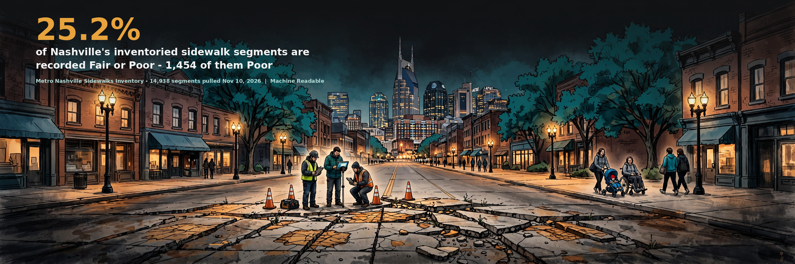

# Nashville Sidewalks Inventory - a Machine Readable data brief



Of **14,938 sidewalk segments** in Nashville's Sidewalks Inventory (1,401.7 miles of recorded length, derived), **9,399 (62.9 percent) are recorded Good, 2,308 (15.5 percent) Fair, and 1,454 (9.7 percent) Poor**. A repair score is recorded for 97.3 percent of Poor segments, while a repair construction cost is recorded for only 69 of the 1,454 Poor segments and for 1,520 of the 9,399 Good segments - so the recorded cost field's $59,743,161.85 sum (on 1,771 cost-carrying segments) is reported as a field sum on its own base, not as a backlog total.

Full brief: [brief-draft.md](brief-draft.md) | Sources: [sources.md](sources.md) | Verification: [verification.md](verification.md)

## Contents

- `brief-draft.md` - the brief
- `hero.png` - headline graphic (generated illustration, brand palette, headline composited on top)
- `charts/` - condition by segment count, condition by length, Poor share by council district, repair-field coverage
- `stats.json` - every headline figure with its population printed
- `data/` - panels (condition, condition as recorded, district), the raw snapshot CSV (the layer carries no personal data - street names and segment fields only, checked in verification.md), the pre-flight audit output, the pull log, the source layer metadata, and the independent verifier output
- `code/` - `pull_data.py`, `audit_section10.py`, `build_stats.py`, `verify_independent.py`, `charts.py`
- `verification.md` - pre-flight audit, methods checklist, sync gate, story gate

## Reproduce

```
python3 code/pull_data.py          # full-layer pull from the live service (snapshot will drift from the archived one)
python3 code/audit_section10.py    # writes data/audit_output.txt
python3 code/build_stats.py        # writes stats.json and data/*_panel.csv
python3 code/verify_independent.py # second implementation (pandas) + live server count
python3 code/charts.py
```

Dependencies (matching the code's actual imports): Python 3 standard library plus pandas (verifier only), matplotlib (charts only), and Pillow (hero composite only). The pull, audit, and build scripts use only the standard library.

## Source

Sidewalks Inventory (Sidewalks_View), Metropolitan Government of Nashville and Davidson County via the Nashville Open Data Portal, ArcGIS FeatureServer layer 0 (services2.arcgis.com/HdTo6HJqh92wn4D8). Snapshot November 10, 2026; lengths in feet as served (Shape__Length, EPSG:2274), mile figures derived.

## License

Brief text and derived data products: CC BY 4.0 (see LICENSE). Underlying records are Metro Nashville government open data.

*Machine Readable is a public-good civic data project by Alex Dowlen.*
